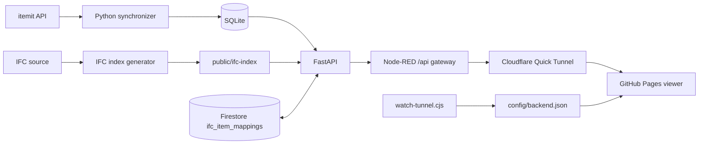

# FOBE-Assets

FOBE-Assets is a Final Year Project for mapping IFC/BIM elements to itemit inventory assets. It joins a Vite browser viewer, an itemit-to-SQLite synchronizer, a FastAPI service, Firestore mapping storage, a Node-RED gateway, Cloudflare Quick Tunnels, and GitHub Pages.

Candidate search never creates a mapping automatically. A mapping is a deliberate relationship between a model key plus IFC GlobalId and an itemit asset ID.

## Architecture



No Node-RED flow export is tracked. Obtain and import the existing flow separately; it must forward the documented `/api` paths to FastAPI.

## Quick start (Windows)

```powershell
git clone <repository-url> FOBE-Assets
Set-Location .\FOBE-Assets
npm ci
py -3.11 -m venv .venv
.\.venv\Scripts\python.exe -m pip install -r .\requirements.txt
.\.venv\Scripts\python.exe -m pip install -r .\FOBE-API\requirements.txt
Copy-Item .\.env.example .\.env
```

Fill in local itemit and Firebase credentials, then:

```powershell
.\.venv\Scripts\python.exe .\main.py
.\.venv\Scripts\python.exe .\FOBE-API\scripts\start_api.py
npm run dev
```

FastAPI defaults to `127.0.0.1:8000`. The current `.env` does not set `FOBE_API_PORT`. If your Node-RED flow targets 8001, set `FOBE_API_PORT=8001` and update the gateway target together.

## Documentation

- [Windows installation](docs/SETUP_WINDOWS.md)
- [Configuration](docs/CONFIGURATION.md)
- [Architecture and data design](docs/ARCHITECTURE.md)
- [API reference](docs/API.md)
- [Project structure and audit](docs/PROJECT_STRUCTURE.md)
- [Deployment](docs/DEPLOYMENT.md)
- [Troubleshooting](docs/TROUBLESHOOTING.md)

## Commands

| Command | Purpose |
| --- | --- |
| `npm run dev` | Vite development server; `/api` proxies to Node-RED. |
| `npm run build` | Generates GitHub Pages artifacts at repository root. |
| `npm test` | Frontend and tunnel watcher tests. |
| `npm run generate:ifc-index` | Rebuilds IFC indexes; requires `IFC_SOURCE_DIR`. |
| `npm run watch:tunnel` | Detects and publishes a changed tunnel URL. |
| `.\.venv\Scripts\python.exe .\main.py` | Synchronizes itemit to SQLite. |
| `.\.venv\Scripts\python.exe .\FOBE-API\scripts\start_api.py` | Starts FastAPI. |

Do not commit `.env`, Firebase service-account JSON, GitHub tokens, or real SQLite data. Mapping writes are disabled by default; the API has no application authentication, so do not expose writes publicly.
